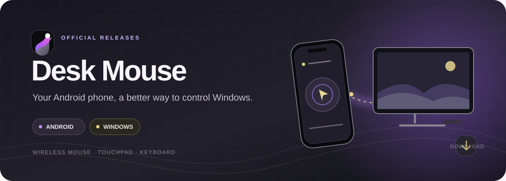

  
    
  
  
  
    
  <a href="https://samirs.xyz/desk-mouse">Product website</a> &nbsp;·&nbsp;
  <a href="https://github.com/aljamesamir4090/DeskMouse-Releases/releases">Release notes</a> &nbsp;·&nbsp;
  <a href="https://github.com/aljamesamir4090/DeskMouse-Releases/issues">Support</a>

 

## Your desktop, at your fingertips.

Desk Mouse turns an Android phone into a wireless mouse, touchpad, and keyboard for a Windows PC. Pair over your local network, then reconnect to trusted computers from the phone app.

## What you can do

|  |  |  |
|:---:|:---:|:---:|
| **🖱️ Mouse & touchpad** Move the pointer and click from your phone. | **⌨️ Keyboard** Type on your PC from the Android app. | **⚡ PC controls** Access supported desktop actions from one place. |
| **🔗 QR or code pairing** Pair with the Windows companion on your network. | **⭐ Trusted computers** Return to saved computers without pairing again. | **🔒 Private connection** Designed for direct local-network use. |

## Download

  
  &nbsp;
  

Open the [latest release](https://github.com/aljamesamir4090/DeskMouse-Releases/releases/latest) and download both companions. Pick the files with the version in their names:

- **Android:** `DeskMouse-Android-vX.Y.Z.apk`
- **Windows:** `DeskMouse-Setup-vX.Y.Z-x64.exe`

## Get connected

1. Install Desk Mouse on your phone and Windows PC.
2. Connect both devices to the same Wi-Fi or local network. Open Desk Mouse on Windows.
3. Pair by scanning the PC's QR code or entering its temporary code.
4. Choose the computer in the Android app to connect.

If Windows asks about Microsoft Defender Firewall, allow Desk Mouse on **Private networks** so your phone can find the PC.

> **Android upgrade note:** If your installed version is older than 2.9.0, uninstall it before installing the current APK. The signing key changed in 2.9.0; uninstalling removes the old app's local data.

## Connection notes

Desk Mouse is designed for local-network use. Keep the phone and PC on the same Wi-Fi or LAN for discovery and control. Pairing establishes trusted access between the devices.

### PC not showing up?

- Confirm both devices are connected to the same network.
- Make sure Desk Mouse is running on Windows.
- Check that Windows Firewall allows Desk Mouse on Private networks.
- For QR or code pairing, keep the Windows companion open on its Pairing page and use a current code.

## Release archive

This repository hosts official Android and Windows builds. Each release includes versioned filenames and release notes. Browse the [latest build](https://github.com/aljamesamir4090/DeskMouse-Releases/releases/latest) or [all releases](https://github.com/aljamesamir4090/DeskMouse-Releases/releases).
